<div align="center">


# Forge411 : l'outil d'upload pour C411

**Créer un torrent, générer le NFO et la présentation, publier sur C411 : en quelques clics, en français.**

Logiciel gratuit et open source pour Windows. Films, séries, musique, livres, BD, jeux, applications… Forge411 analyse ce que tu partages,
retrouve la fiche, nomme la release selon les règles C411, écrit le NFO et la présentation,
crée le torrent et l'envoie. Tu n'as qu'à vérifier.

[**Télécharger Forge411 pour Windows**](../../releases/latest) · [Visite guidée](#visite-guidée) · [Questions fréquentes](#questions-fréquentes)


</div>

---

## Ce que Forge411 fait pour toi

- **Reconnaît le contenu** d'un fichier ou d'un dossier entier : film, épisode, saison complète, album, livre, BD, jeu, application, ROM, carte GPS, modèle 3D, contenu adulte (XXX).
- **Lit les fichiers** : pistes audio et sous-titres d'une vidéo, tags d'un album, métadonnées d'un EPUB, type de release d'un jeu (scène, repack, portable, GOG…).
- **Retrouve la fiche** sur TMDB, MusicBrainz, Open Library, RAWG ou ThePornDB : titre français, résumé, affiche, genres.
- **Nomme la release** selon le modèle C411 de la catégorie (HDLight/4KLight selon le débit, WEB ou WEBRip, codec…) et vérifie le nom pendant que tu le modifies.
- **Écrit le NFO** et **la présentation BBCode**, prêts à l'emploi et modifiables.
- **Remplit les options C411** (langue, genres, format, saison, épisode, console…) d'après les données du site.
- **Crée le torrent** privé, avec la bonne taille de pièce et la source `C411` : le torrent que tu seedes est exactement celui publié.
- **Vérifie le seed** dans ton client torrent (qBittorrent, Transmission, Deluge) avant de publier.
- **Cherche les doublons** déjà sur C411 et estime si le slot est occupé, avec la justification hors slot si besoin.
- **Ajoute des captures d'écran** d'une vidéo, hébergées sur un site accepté par C411.
- **Envoie** en brouillon (à relire sur C411) ou publie directement ; le **mode lot** traite un dossier entier d'un coup.
- **Affiche ton profil C411** (niveau, ratio, Zen, évolution) et se **met à jour** tout seul depuis GitHub.
- **Te prévient** de ce que C411 refuserait : formats interdits, saison incomplète, sous-titres traduits automatiquement, team bannie, débit sous le minimum, fichiers sans le tag de team (detag), pochette ou tags audio manquants, GCODE…

## Types pris en charge

| Catégorie C411 | Reconnu à partir de | Fiche en ligne | Automatique |
|---|---|---|---|
| 🎬 Films & Vidéos | mkv, mp4, avi, ts… | TMDB | Langue, résolution, codecs, HDR, HDLight/4KLight, débit vidéo, saison/épisode, sous-catégorie (film, série, animation, documentaire…) |
| 🎵 Audio | flac, mp3, m4a, ogg… | MusicBrainz | Artiste, album, année, qualité (`FLAC[24bit.96kHz]`, `MP3[320kbps]`…), tracklist, contrôle de la pochette et des tags |
| 📚 Ebook | epub, pdf, cbz, cbr, m4b… | Open Library | Titre, auteur, format, pages, livres audio |
| 🎮 Jeux Vidéo | exe, steam_api, nsp, xci, pkg… | RAWG | Type de release, console, configuration requise |
| 🧩 Applications | setup, msi, dmg, apk… | Aucune | Type (KEYGEN, CRACK, PORTABLE…), système, version |
| 🕹️ Émulation | ROM (nes, sfc, gba…), bin/cue, chd | Aucune | Machine, région, langues, contrôle des images CD |
| 🧭 GPS | img, gmap, obf… | Aucune | Marque, zone, version |
| 🧱 Impression 3D | stl, 3mf, step, lys, chitubox | Aucune | Formats, pack, scan/resculpt, mention NSFW |
| 🔞 XXX | `[Studio]`, `JAV`, `[HENTAI]`, noms de studios… | ThePornDB (Films, VR) | Modèle studio / pack / JAV / hentai / images, sous-catégorie (Films, VR, Hentai, Images, Ebooks, Jeux), langue et qualité, contrôle des interdits (amateur, rips d'hébergeurs, archives, SWF/FLV/RM) |

---

## Installation

### Windows (recommandé)

1. Télécharge **`Forge411.exe`** depuis la [dernière version](../../releases/latest).
2. Double-clique dessus. C'est tout : rien d'autre à installer.

> Windows peut afficher « Windows a protégé votre ordinateur » au premier lancement, car l'exécutable n'est pas signé.
> Clique sur **Informations complémentaires**, puis **Exécuter quand même**.

### Depuis le code source (Windows, Linux, macOS)

Il faut [Python 3.10 ou plus récent](https://www.python.org/downloads/).

- **Windows** : télécharge le code, puis double-clique sur `install.bat`. Il prépare tout et crée un raccourci sur le Bureau.
- **Linux / macOS** :
  ```bash
  python3 -m venv .venv
  .venv/bin/pip install -r requirements.txt
  .venv/bin/python Forge411.pyw
  ```
  Sous Linux, installe aussi `libmediainfo` et `python3-tk` avec le gestionnaire de paquets de ta distribution.

---

## Premier lancement

Forge411 ouvre ses **paramètres**, rangés par sections (Compte C411, Bases en ligne, Uploads, Client torrent, Captures, Général). Une pastille signale ce qui manque. Chaque clé a un lien pour l'obtenir, un bouton **Tester** et une aide au survol du « ? ».

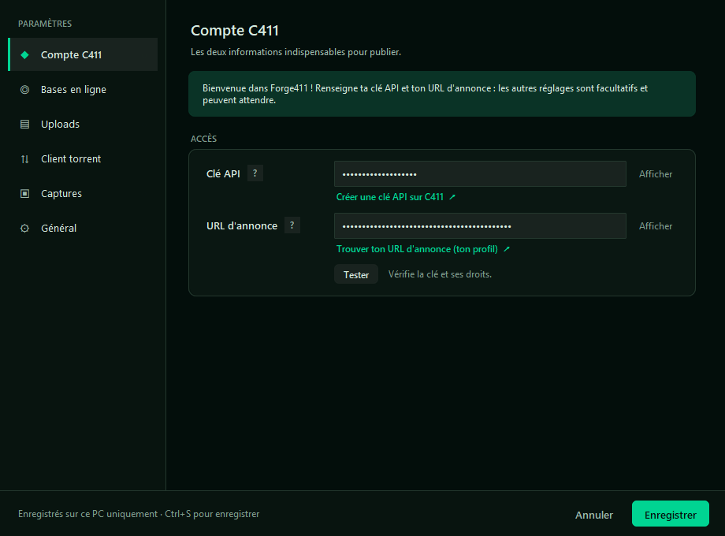

| Paramètre | Obligatoire | Où le trouver |
|---|---|---|
| Clé API C411 | Oui | Sur C411 : profil › Intégrations. Coche le droit **brouillons** ; ajoute **upload** pour publier directement et **Profil (lecture)** pour la page *Mon profil*. Un droit ne s'ajoute pas à une clé existante : crée une nouvelle clé. |
| URL d'annonce | Oui | Ton URL personnelle `https://c411.org/announce/…`, sur ton profil C411. Elle identifie ton compte : ne la partage jamais. |
| Clé TMDB | Pour les films et séries | [themoviedb.org › API](https://www.themoviedb.org/settings/api), gratuite. |
| Clé RAWG | Pour les jeux | [rawg.io › API](https://rawg.io/apidocs), gratuite. |
| Clé Google Books | Non | Facultative : sans elle, Forge411 utilise Open Library. |
| Jeton ThePornDB | Pour XXX Films et VR | Jeton personnel sur [theporndb.net](https://theporndb.net/) (compte › API Tokens). La fiche choisie (studio, date, interprètes, image) remplit le nom et la présentation et est jointe à l'upload. |
| Tag d'équipe | Non | Ton tag, proposé à la place de NOTAG quand la source n'a pas de tag (tes propres releases). Une release reprise garde toujours le tag d'origine. |
| Dossier de sortie | Non | Où sont écrits les `.torrent` et les `.nfo`. |
| Dossier de seed | Non | Là où ton client torrent attend les données ; Forge411 vérifie que tes fichiers s'y trouvent. |
| Apparence | Non | Mode **Système** (suit Windows), **Sombre** ou **Clair**, aux couleurs de C411. Appliqué au redémarrage. |


La musique (MusicBrainz) et les livres (Open Library) ne demandent aucune clé. Sans clé TMDB ou RAWG, tu peux toujours saisir la fiche à la main.

---

## Visite guidée

Au premier lancement, une visite guidée présente l'interface. Tu peux la relancer à tout moment avec l'icône ✦, en bas du menu de gauche, à côté de la version (l'icône ⟳ cherche les mises à jour).


Partout, survole un **?** pour savoir à quoi sert un champ.


### 1. Source

Choisis un fichier ou un dossier. Forge411 reconnaît le type de contenu, propose la sous-catégorie C411 et affiche ce qu'il a lu. Pour une vidéo dont le débit n'est pas indiqué, le premier fichier est analysé en entier (quelques secondes) : C411 exige le débit vidéo dans le NFO. Si le type est mal reconnu, change-le dans la liste : l'analyse est relancée.


Les problèmes bloquants sont en rouge, les conseils en orange.

### 2. Identification

La fiche est cherchée et sélectionnée automatiquement. Clique sur un autre résultat si ce n'est pas le bon, ou passe en **saisie manuelle**. Pour un film ou une série, Forge411 liste aussi les releases déjà présentes sur C411, pour éviter les doublons.

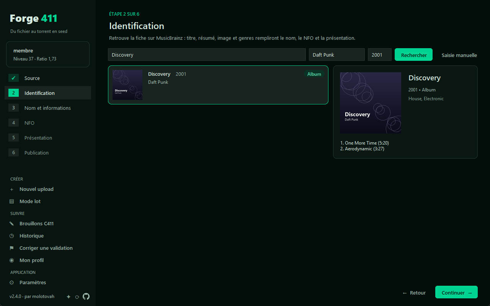

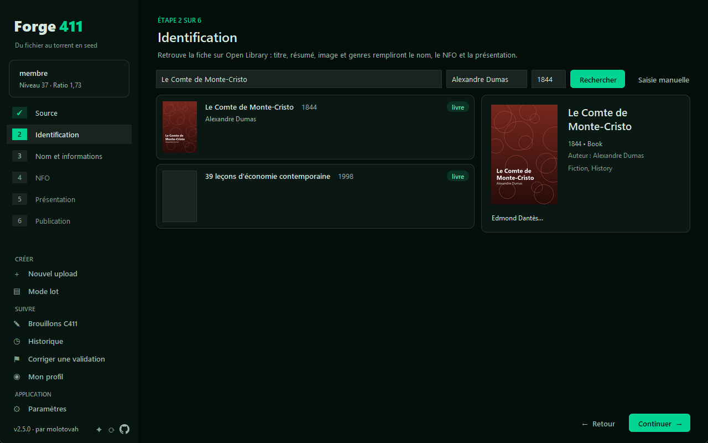

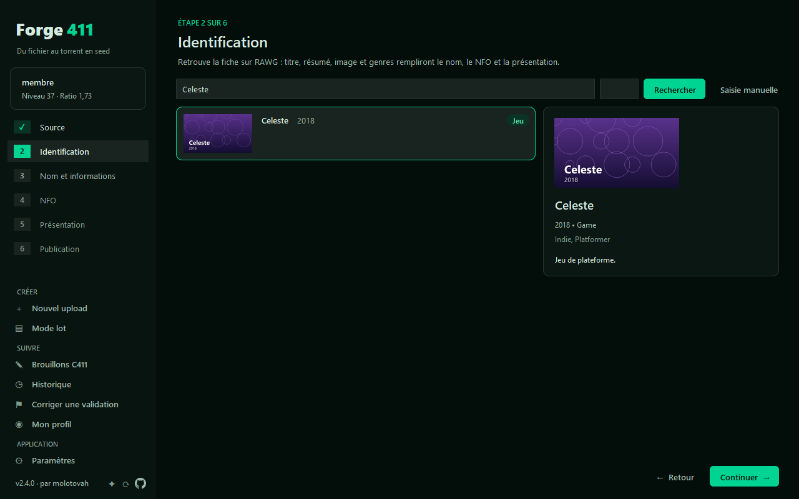

### 3. Nom et informations

Le nom est construit selon le modèle C411 de la catégorie, rappelé en haut de l'écran. Modifie un composant pour reconstruire le nom ; il est vérifié en direct. Plus bas, les **informations complémentaires** (plateforme VOD, version, configuration requise, instructions d'installation…) alimentent le NFO et la présentation.


Pour un jeu ou une application, le type de release est déduit des fichiers présents, selon la table de C411 :

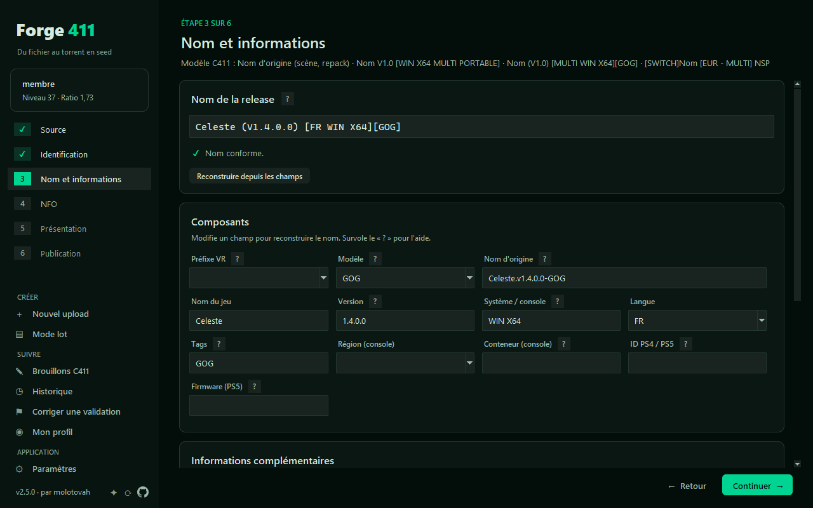

Le nom de tes fichiers d'origine est conservé, comme le demande C411 pour les réuploads. Si un fichier vidéo ne se termine pas par le tag de team (règle anti-detag), Forge411 propose de l'ajouter (`Episode.01.mkv` → `Episode.01-TEAM.mkv`).

### 4. NFO

Le NFO est généré : en-tête, fiche, informations techniques, liste des fichiers et, pour une vidéo, la sortie MediaInfo complète. Tu peux le modifier ou importer le NFO d'origine de la release.


### 5. Présentation

La sous-catégorie et les options C411 sont préremplies ; les options obligatoires manquantes apparaissent en rouge. La description BBCode (image, résumé, fiche, informations techniques) est prête et modifiable. C411 exige une image : sans fiche en ligne, colle l'adresse d'une image dans la fiche manuelle.

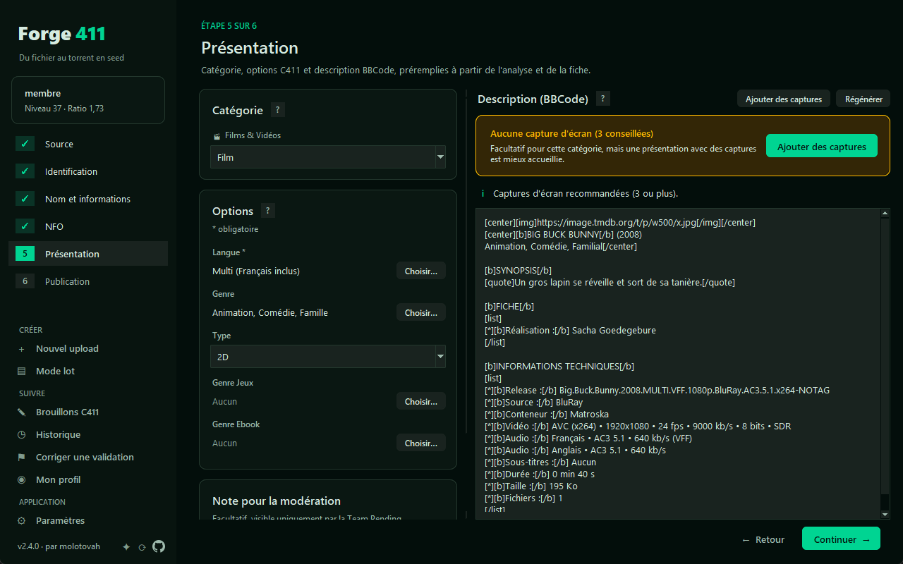

### 6. Publication

Forge411 crée le torrent, affiche ce qu'il reste à vérifier, puis l'envoie. Pendant le hachage du torrent puis la vérification des données par ton client torrent, des tuiles indiquent la vitesse, le temps écoulé, le temps restant et l'avancement (pièces hachées, part vérifiée) ; à la fin, la durée totale et la vitesse moyenne.

- **Enregistrer en brouillon** : tout part sur C411 sans être publié. Sur la page d'upload du site, clique sur **Brouillons** puis sur ton brouillon pour le relire et le publier. Idéal pour commencer.
- **Publier sur C411** : publication directe. Le bouton reste grisé tant que le seed n'est pas vérifié (client configuré) ou confirmé (case à cocher), et tant que la présentation n'a pas ses captures.

Tant que tu n'es pas **uploader certifié** (15 torrents validés), C411 n'accepte qu'un upload à la fois en attente de la Team Pending, modification demandée comprise. Si un upload publié avec Forge411 attend encore sa validation, l'étape Publication le signale et conseille d'enregistrer le nouveau en brouillon. L'API ne donne pas ce statut : Forge411 compte les uploads validés de son historique. Si tu es déjà certifié, coche la case dans Paramètres › Uploads › Statut d'uploader. Un torrent refusé ou supprimé reste invisible pour l'API : marque-le dans l'Historique (clic droit, « Marquer comme refusé ou supprimé ») pour qu'il ne compte plus.

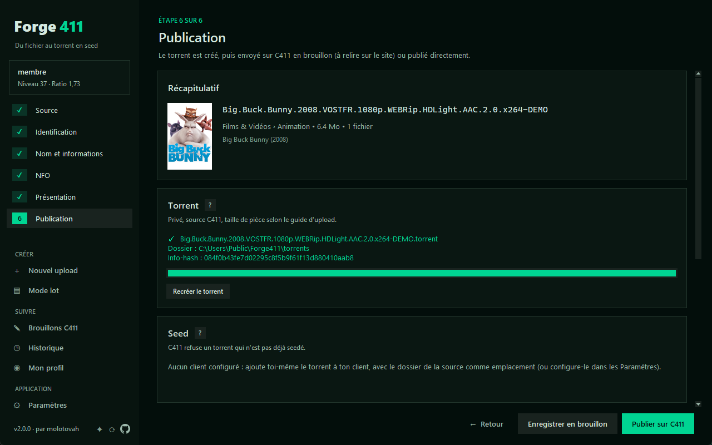

---

## Mode lot

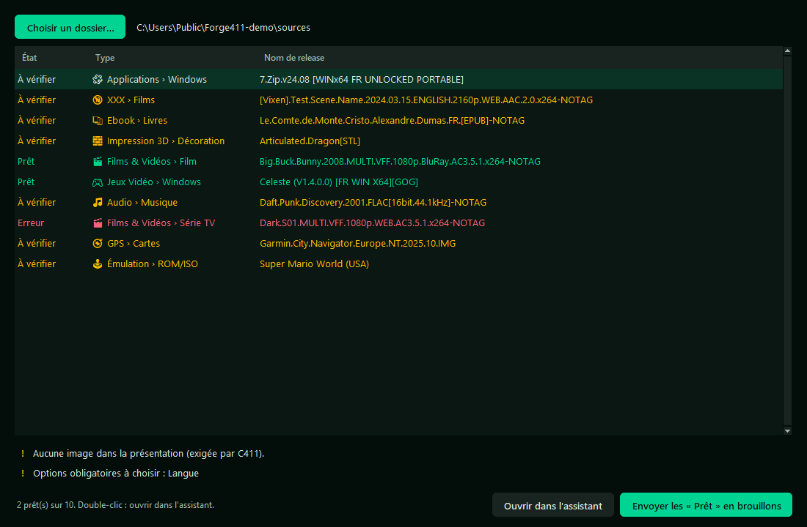

**Mode lot** traite toutes les sources d'un dossier (un sous-dossier ou un fichier = une release) : détection, analyse, fiche en ligne quand le titre correspond, nom, NFO, présentation et options. Chaque ligne passe à **Prêt**, **À vérifier** (doute sur la fiche, image ou option manquante) ou **Erreur**. Un double-clic ouvre l'élément dans l'assistant. « Envoyer les Prêt » crée les torrents, les ajoute au client torrent s'il est configuré et envoie des **brouillons** (15 au maximum sur C411) : la publication se fait ensuite depuis le site.

## Brouillons C411


**Brouillons C411** liste tes brouillons (compteur sur 15), ouvre la page d'upload pour les reprendre et permet d'en supprimer.

## Historique

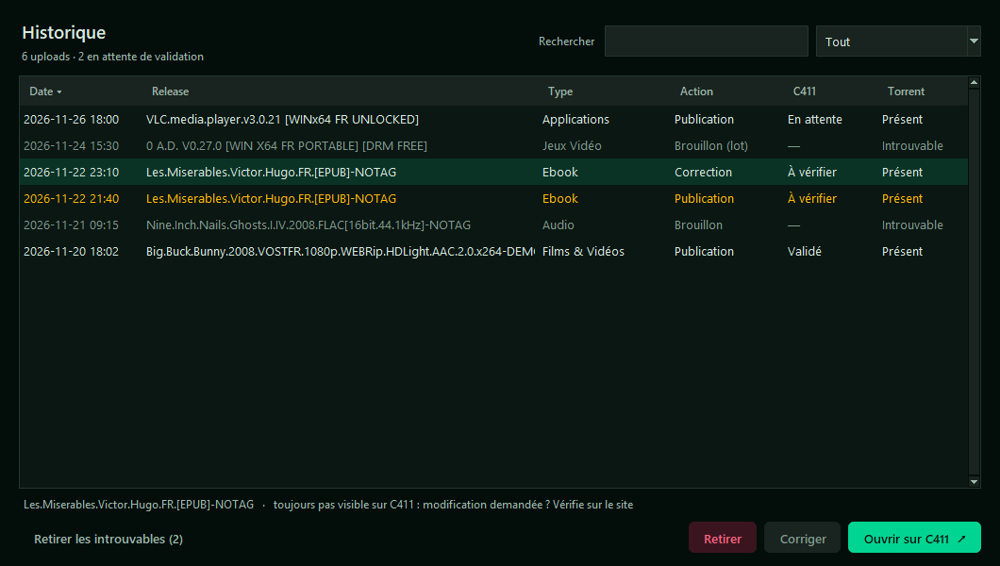

**Historique** liste tes uploads dans un tableau. Clique sur un en-tête pour trier. Tu peux chercher par nom ou par type, et filtrer : publiés, brouillons, corrections ou torrent introuvable. La colonne **Torrent** indique si le fichier .torrent existe encore. Un double-clic ouvre la page sur C411. Le clic droit propose de copier le nom, d'afficher le .torrent ou de corriger l'upload. **Retirer** (ou la touche Suppr) enlève les lignes sélectionnées. **Retirer les introuvables** enlève en une fois les uploads dont le .torrent a disparu. Seul l'historique change : rien n'est supprimé sur C411, et les .torrent restent sur le disque.

La colonne **C411** suit la validation par la Team Pending. Forge411 interroge C411 à son démarrage, à l'ouverture de l'historique, puis toutes les 30 minutes pour chaque upload publié pas encore validé. Une notification s'affiche dès qu'un torrent passe **Validé**, et l'heure de validation est notée. L'API ne montre un torrent qu'une fois validé : tant qu'il n'est pas visible, la ligne indique **En attente**, puis **À vérifier** au-delà de 3 jours après la dernière soumission (une modification a peut-être été demandée : vérifie sur le site). Le filtre « En attente C411 » les regroupe. Les brouillons ne sont pas suivis.


## Client torrent et seed

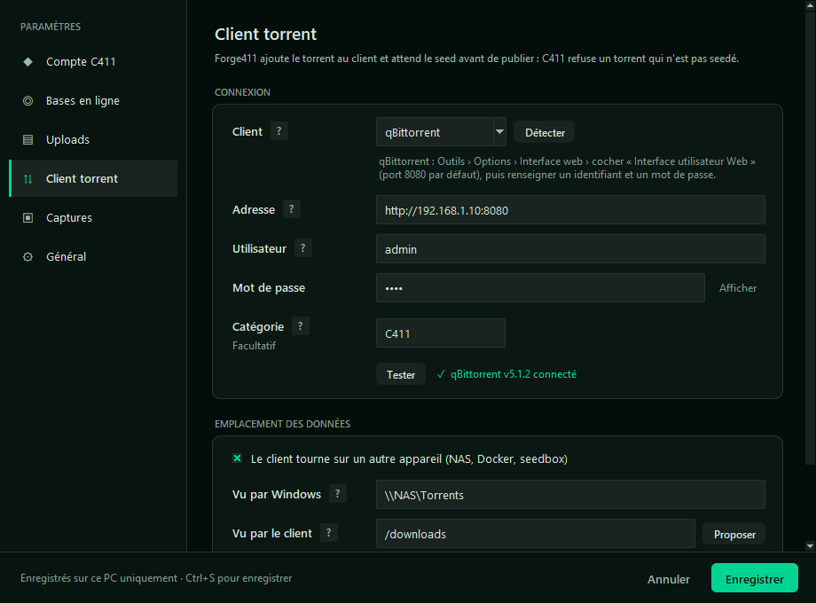

Dans **Paramètres › Client torrent**, choisis qBittorrent, Transmission ou Deluge, ou clique sur **Détecter** : Forge411 cherche les clients sur ce PC et sur la machine de ton dossier de seed. L'aide affichée explique comment activer l'interface web. Après la création du torrent, Forge411 l'ajoute au client avec le dossier de la source comme emplacement, suit la vérification des données et affiche **En seed** : C411 refuse un torrent publié qui n'est pas déjà seedé. Sans client configuré, ajoute le torrent toi-même (voir *Seed automatique*).

Client sur un autre appareil (Docker, NAS) : coche l'option correspondante, puis renseigne la **correspondance des dossiers**, c'est-à-dire le même dossier vu par Forge411 et par le client, par exemple `\\192.168.1.251\Torrents` côté Windows et `/downloads` dans le conteneur. **Proposer** la déduit de ton dossier de seed et du dossier par défaut du client. L'aperçu montre le chemin exact transmis au client. Le nom de la machine et son adresse IP sont reconnus comme le même partage : `\\NAS\Torrents` et `\\192.168.1.251\Torrents` conviennent tous deux. L'interface web du client doit être joignable depuis ton PC et demander un identifiant.

## Corriger une validation


Quand la Team Pending passe ton torrent en **Modification demandée**, clique sur **Corriger une validation** (menu Suivre, ou **Corriger** dans l'Historique). Choisis l'upload et colle le message de la Team Pending, copié depuis *Discussion de modération* sur la page du torrent. Forge411 rouvre l'upload, avec le même .torrent et le même seed, puis avance seul. Il choisit la fiche, recalcule le nom avec les règles actuelles (en reprenant du titre publié ce qui manque au nom du fichier) et régénère le NFO et la présentation. Il s'arrête à la première étape qui te demande une action, par exemple les captures. Chaque étape affiche les points de la Team Pending qui la concernent. À l'étape Publication, copie le titre, la description et le NFO corrigés, puis ouvre la page du torrent. Clique sur **Modifier**, colle, enregistre, puis clique sur **Soumettre pour re-examen**. L'API C411 ne permet pas de modifier un torrent à ta place.

## Doublons, slots et justification

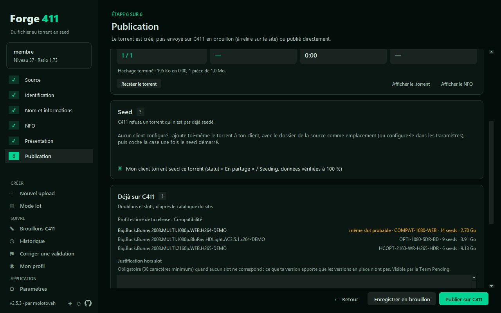

À l'étape Publication, **Déjà sur C411** cherche les releases existantes (API Torznab de C411) : même nom (doublon) et releases du même profil de slot (Home Cinéma Pure, Home Cinéma Optimisé, Optimisation, Compatibilité) et de même résolution. Si le slot semble occupé, rédige la **justification hors slot** (30 caractères minimum) : elle est envoyée avec l'upload. L'attribution réelle du slot reste décidée par C411.

## Captures d'écran

Pour une vidéo, **Ajouter des captures** (étape Présentation) extrait des images avec ffmpeg, les envoie sur pixhost ou catbox (hébergeurs acceptés par C411) et ajoute les vignettes à la description. Sans vidéo, choisis des images sur le disque. Pour le XXX, la Team Pending ne compte que postimg.cc et zupimages.net. Forge411 extrait les captures dans un dossier et ouvre postimages.org : tu y glisses les images, puis tu colles la liste des **liens directs**. Minimum exigé hors bannière : XXX 3 (4 pour un pack), jeux 3, applications 2. Les images hors liste blanche C411 sont signalées. L'envoi demande toujours ta confirmation. Les captures extraites sont rangées dans le sous-dossier « captures » du dossier de sortie. Forge411 supprime celles d'une release dès que C411 l'a validée (colonne C411 de l'historique) : les images sont hébergées et leurs liens figurent dans la présentation. Le NFO de la release (sous-dossier « nfo » du dossier de sortie) est supprimé au même moment : il est en ligne avec le torrent. Les NFO des sources ne sont jamais touchés. Tant que le torrent est en attente, ou pour un brouillon, elles sont gardées : une modification demandée peut en réclamer de nouvelles. Sans ffmpeg sur le PC, Forge411 propose de l'installer en un clic (Paramètres › Captures d'écran, ou au premier clic sur « Ajouter des captures ») : version stable officielle (FFmpeg-Builds, LGPL) téléchargée depuis GitHub, vérifiée par SHA-256, environ 75 Mo. Un ffmpeg déjà présent (PATH, winget) est utilisé en priorité.

## Reprise d'un upload

L'upload en cours est sauvegardé à chaque étape. Après une fermeture ou un plantage, Forge411 propose de le reprendre au lancement suivant.

## Mon profil


Le bouton **Mon profil** (et le résumé en haut de la barre latérale) affiche ton compte C411 : niveau et progression, classe, palier et avancement des quatre voies, ratio, volumes envoyés et reçus (crédits compris), solde de Zen, équipe et son tag, état du téléchargement, freeleech et silverleech. La clé API doit avoir le droit **Profil (lecture)**. C411 rafraîchit ces données au plus toutes les 30 secondes. La carte **Évolution** compare avec un relevé précédent (gardé localement, au plus un par heure) : ratio, volume envoyé, Zen, quêtes et estimation du prochain niveau.

## Seed automatique

Pour que le seed démarre sans intervention :

1. Dans ton client torrent, fais surveiller le dossier `torrents` du **dossier de sortie** de Forge411.
2. Comme emplacement des données, indique ton **dossier de seed**, celui où se trouvent les fichiers partagés.

Chaque torrent créé par Forge411 part alors en seed tout seul.

> **qBittorrent** supprime les `.torrent` d'un dossier surveillé dès qu'il les a ajoutés. Forge411 a encore besoin du fichier au moment de l'envoi : fais surveiller une **copie** du dossier (par une synchronisation) plutôt que le dossier lui-même.

---

## Questions fréquentes

**La recherche ne trouve rien.**
Essaie le titre original, retire l'année, ou passe en saisie manuelle. MusicBrainz limite le nombre de requêtes : patiente quelques secondes si la recherche échoue.

**Un champ obligatoire est en rouge à l'étape Présentation.**
C411 attend une valeur que Forge411 n'a pas pu deviner : choisis-la dans la liste.

**Le renommage échoue.**
Ferme le programme qui utilise le fichier (lecteur vidéo, client torrent), puis clique à nouveau sur **Continuer**.

**C411 refuse le torrent publié.**
Ton client doit seeder le torrent avant la publication : configure ton client dans les Paramètres pour que Forge411 le vérifie. En cas de doute, commence par un brouillon.

**Comment mettre Forge411 à jour ?**
Au démarrage puis toutes les 6 heures, Forge411 cherche une nouvelle version sur GitHub (désactivable dans les Paramètres). Si une version existe, une pastille apparaît sur l'icône ⟳ et un badge en haut à droite. Un clic affiche les nouveautés de chaque version depuis la tienne, avant tout téléchargement. L'exécutable Windows télécharge la nouvelle version et vérifie son empreinte SHA-256. Il attend la fin de l'analyse de l'antivirus Windows, puis la nouvelle version remplace l'ancienne et redémarre, sans script intermédiaire. Depuis le code source : `git pull`.

**Où sont mes réglages et le journal ?**
Dans `%APPDATA%\Forge411` sous Windows (`~/.config/Forge411` sous Linux) : `config.json`, `history.jsonl` et `forge411.log`. Joins le journal si tu signales un problème.

## Confidentialité

- Tes clés et ton URL d'annonce restent sur ton ordinateur, dans `config.json`.
- Forge411 contacte uniquement C411 (envoi, options, doublons), les bases de fiches (titres recherchés) et GitHub (vérification et téléchargement des mises à jour, sans aucune donnée personnelle). Aucune statistique, aucun autre serveur.

## Pour les développeurs

Architecture, tests, compilation de l'exécutable et ajout d'un type de contenu : voir [docs/DEVELOPPEMENT.md](docs/DEVELOPPEMENT.md).

## Mots-clés

Outil d'upload C411 · créateur de torrent privé · générateur de NFO · générateur de présentation BBCode · nommage des releases · MediaInfo · TMDB · MusicBrainz · RAWG · Open Library · qBittorrent · seed automatique · tracker privé français · uploader torrent Windows.

## Licence

Développé par [molotovah](https://github.com/molotovah). Logiciel libre sous [GNU GPL version 3](LICENSE), avec les conditions supplémentaires de l'article 7 décrites dans [NOTICE](NOTICE) : une version modifiée reste sous GPL, garde la mention « Forge411 par molotovah » visible dans son interface et se présente comme modifiée. Forge411 n'est pas affilié à C411.

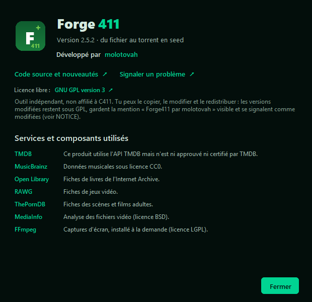

Dans l'application, un clic sur la version (en bas du menu) ouvre la fenêtre **À propos** : auteur, licence et services utilisés (TMDB, MusicBrainz, Open Library, RAWG, ThePornDB, MediaInfo, FFmpeg). Ce produit utilise l'API TMDB mais n'est ni approuvé ni certifié par TMDB.
