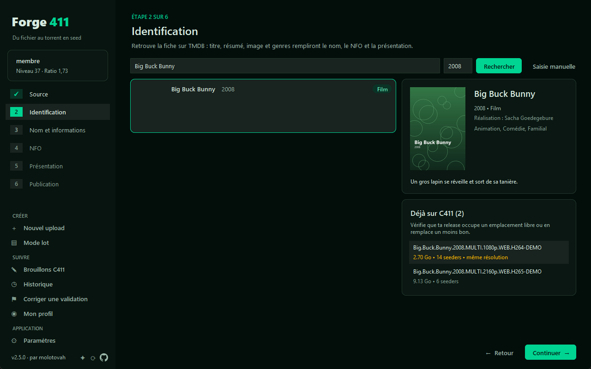
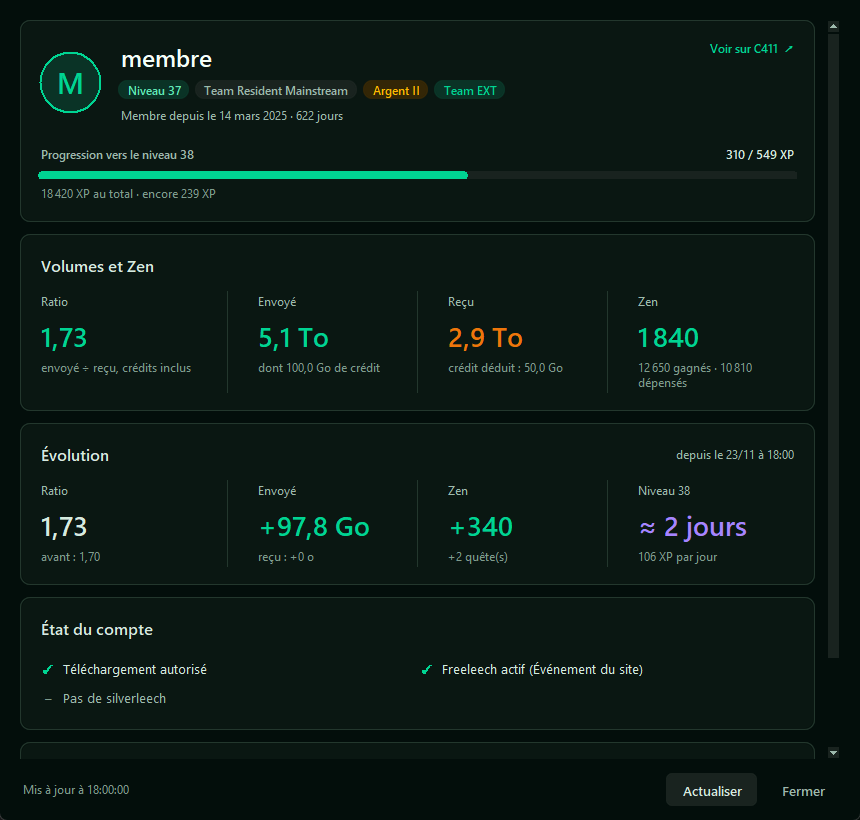
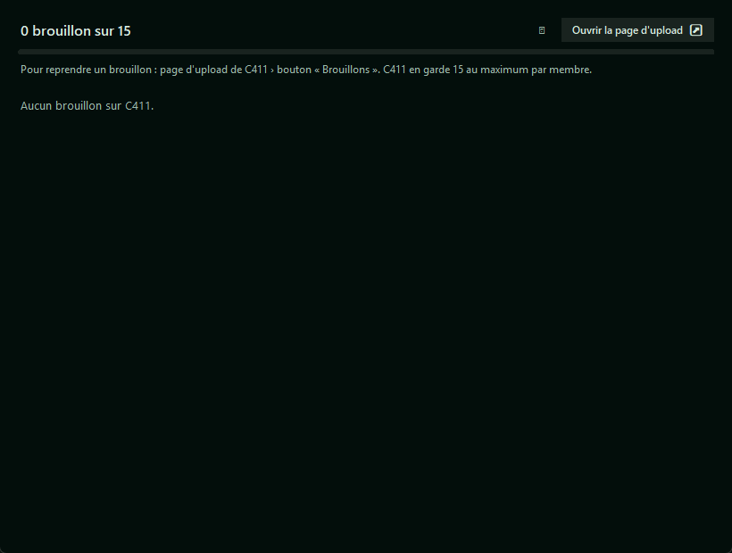

# Forge411

**L'outil d'upload pour C411, en français : du fichier au torrent en seed, en quelques clics.**

[**⬇ Télécharger pour Windows**](../../releases/latest) · [📖 Wiki](../../wiki) · [🆕 Nouveautés](CHANGELOG.md) · [🐞 Signaler un problème](../../issues)

Forge411 analyse ce que tu partages, retrouve la fiche, nomme la release selon les règles C411, écrit le NFO et la présentation, crée le torrent, vérifie le seed dans ton client et envoie le tout. **Tu n'as qu'à vérifier.** Gratuit et open source.

> [!NOTE]
> Forge411 est un outil indépendant, non affilié à C411.

## Ce que Forge411 fait pour toi

| | |
|---|---|
| 🔎 **Reconnaît et lit** | Film, épisode, saison, album, livre, BD, jeu, application, ROM, carte GPS, modèle 3D, XXX : pistes audio et sous-titres, tags, métadonnées, type de release. |
| 🗂️ **Retrouve la fiche** | TMDB, MusicBrainz, Open Library, RAWG, ThePornDB : titre français, résumé, affiche, genres. |
| 🏷️ **Nomme la release** | Selon le modèle C411 de la catégorie (HDLight/4KLight selon le débit, WEB ou WEBRip, codec…), vérifié pendant que tu le modifies. |
| 📝 **Écrit NFO et présentation** | NFO et BBCode prêts à l'emploi, options C411 préremplies, captures d'écran hébergées sur un site accepté. |
| 🧲 **Crée le torrent et vérifie le seed** | Torrent privé, source `C411`, bonne taille de pièce ; ajouté à qBittorrent, Transmission ou Deluge (PC, NAS, Docker ou seedbox). |
| 🛡️ **Te prévient avant C411** | Doublons et slots, formats interdits, saison incomplète, team bannie, débit trop bas, detag, captures manquantes, un seul upload en attente tant que tu n'es pas certifié… |
| 📬 **Envoie et suit** | Brouillon ou publication directe, mode lot, historique avec suivi de la validation par la Team Pending, correction guidée. |

<b>Types de contenu pris en charge</b>

| Catégorie C411 | Reconnu à partir de | Fiche en ligne | Automatique |
|---|---|---|---|
| 🎬 Films & Vidéos | mkv, mp4, avi, ts… | TMDB | Langue, résolution, codecs, HDR, HDLight/4KLight, débit vidéo, saison/épisode, sous-catégorie |
| 🎵 Audio | flac, mp3, m4a, ogg… | MusicBrainz | Artiste, album, année, qualité (`FLAC[24bit.96kHz]`, `MP3[320kbps]`…), tracklist, pochette et tags |
| 📚 Ebook | epub, pdf, cbz, cbr, m4b… | Open Library | Titre, auteur, format, pages, livres audio |
| 🎮 Jeux Vidéo | exe, steam_api, nsp, xci, pkg… | RAWG | Type de release, console, configuration requise |
| 🧩 Applications | setup, msi, dmg, apk… | Aucune | Type (KEYGEN, CRACK, PORTABLE…), système, version |
| 🕹 Émulation | ROM (nes, sfc, gba…), bin/cue, chd | Aucune | Machine, région, langues, contrôle des images CD |
| 🧭 GPS | img, gmap, obf… | Aucune | Marque, zone, version |
| 🧱 Impression 3D | stl, 3mf, step, lys, chitubox | Aucune | Formats, pack, scan/resculpt, mention NSFW |
| 🔞 XXX | `[Studio]`, `JAV`, `[HENTAI]`… | ThePornDB (Films, VR) | Modèle studio / pack / JAV / hentai / images, sous-catégorie, langue et qualité, contrôle des interdits |

## Aperçu

<table>
<tr>
<td width="50%">
<picture>
  <source media="(prefers-color-scheme: light)" srcset="docs/screenshots/18-parametres-client-clair.png">
  
</picture>

<b>Client torrent</b> : PC, NAS, Docker ou seedbox

</td>
<td width="50%">
<picture>
  <source media="(prefers-color-scheme: light)" srcset="docs/screenshots/25-historique-clair.png">
  
</picture>

<b>Historique</b> : suivi de la validation C411

</td>
</tr>
<tr>
<td width="50%">
<picture>
  <source media="(prefers-color-scheme: light)" srcset="docs/screenshots/19-profil-clair.png">
  
</picture>

<b>Mon profil</b> : niveau, ratio, Zen, évolution

</td>
<td width="50%">
<picture>
  <source media="(prefers-color-scheme: light)" srcset="docs/screenshots/21-brouillons-clair.png">
  
</picture>

<b>Brouillons C411</b> : à relire et publier sur le site

</td>
</tr>
</table>

## Démarrage rapide

1. **Télécharge** [`Forge411.exe`](../../releases/latest) et lance-le. Rien d'autre à installer.
2. **Renseigne** ta clé API C411 (profil › Intégrations, droit **brouillons**) et ton URL d'annonce. Les autres réglages peuvent attendre.
3. **Choisis** un fichier ou un dossier : Forge411 le reconnaît et l'analyse.
4. **Suis les 6 étapes** de l'assistant : fiche, nom, NFO, présentation, puis torrent.
5. **Commence par un brouillon** : tu le relis et le publies depuis la page d'upload de C411.

> [!NOTE]
> Au premier lancement, Windows peut afficher « Windows a protégé votre ordinateur » : l'exécutable n'est pas signé. Clique sur **Informations complémentaires**, puis **Exécuter quand même**.

> [!CAUTION]
> Ton URL d'annonce identifie ton compte C411. Ne la partage jamais, ni en capture d'écran.

Forge411 se met ensuite à jour tout seul. Depuis le code source (Windows, Linux, macOS) : voir [Installation](../../wiki/Installation).

## Documentation

Le guide complet est dans le **[wiki](../../wiki)** :

| Bien démarrer | Au quotidien | Aide |
|---|---|---|
| [Installation](../../wiki/Installation) | [Mode lot](../../wiki/Mode-lot) | [Questions fréquentes](../../wiki/Questions-fr%C3%A9quentes) |
| [Premier lancement](../../wiki/Premier-lancement) | [Brouillons et historique](../../wiki/Brouillons-et-historique) | [Confidentialité](../../wiki/Confidentialit%C3%A9) |
| [Assistant pas à pas](../../wiki/Assistant-pas-%C3%A0-pas) | [Corriger une validation](../../wiki/Corriger-une-validation) | [Mises à jour](../../wiki/Mises-%C3%A0-jour) |
| [Client torrent et seed](../../wiki/Client-torrent-et-seed) | [Doublons et slots](../../wiki/Doublons-et-slots) | [Développement](../../wiki/D%C3%A9veloppement) |
| | [Captures d'écran](../../wiki/Captures-d%E2%80%99%C3%A9cran) · [Mon profil](../../wiki/Mon-profil) | |

<b>Confidentialité</b>

Tes clés et ton URL d'annonce restent sur ton ordinateur. Forge411 ne contacte que C411, les bases de fiches (titres recherchés), les hébergeurs d'images quand tu ajoutes des captures, ton client torrent et GitHub (mises à jour, sans donnée personnelle). Aucune statistique. Détails : [Confidentialité](../../wiki/Confidentialit%C3%A9).

## Contribuer

Les problèmes et idées se signalent dans les [issues](../../issues) : joins le journal `forge411.log` (`%APPDATA%\Forge411`). Architecture, tests et compilation : [docs/DEVELOPPEMENT.md](docs/DEVELOPPEMENT.md). Le wiki se modifie dans [`docs/wiki/`](docs/wiki) par pull request.

## Licence

Développé par [molotovah](https://github.com/molotovah). Logiciel libre sous [GNU GPL version 3](LICENSE), avec les conditions supplémentaires de l'article 7 décrites dans [NOTICE](NOTICE) : une version modifiée reste sous GPL, garde la mention « Forge411 par molotovah » visible dans son interface et se présente comme modifiée.

Ce produit utilise l'API TMDB mais n'est ni approuvé ni certifié par TMDB.

Outil d'upload C411 · créateur de torrent privé · générateur de NFO · générateur de présentation BBCode · nommage des releases · MediaInfo · TMDB · MusicBrainz · RAWG · Open Library · qBittorrent · seed automatique · tracker privé français · uploader torrent Windows
