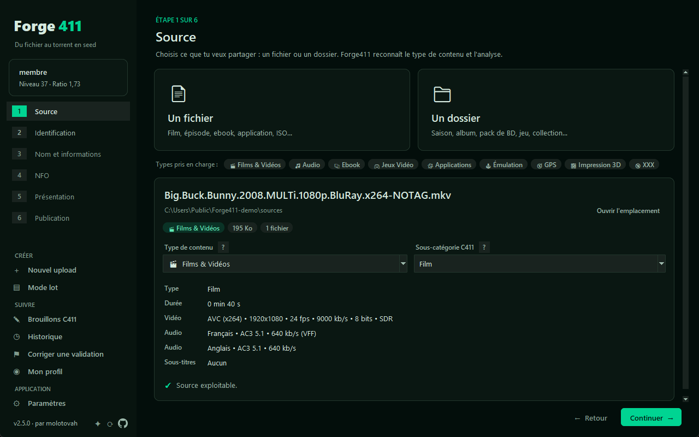
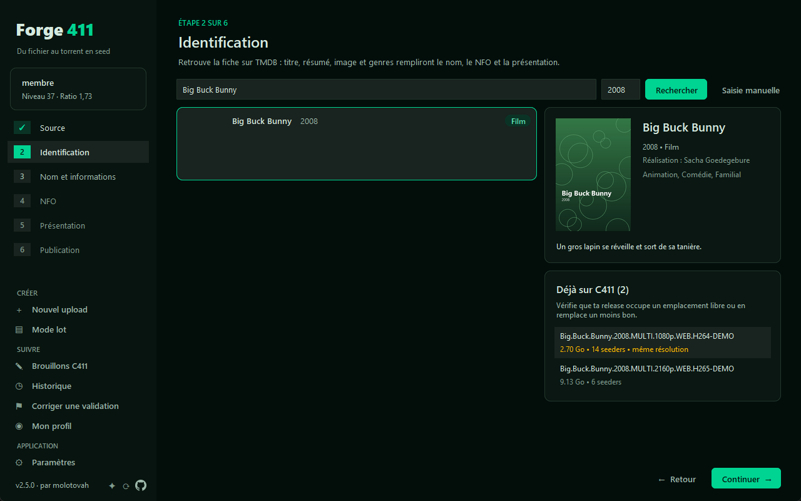
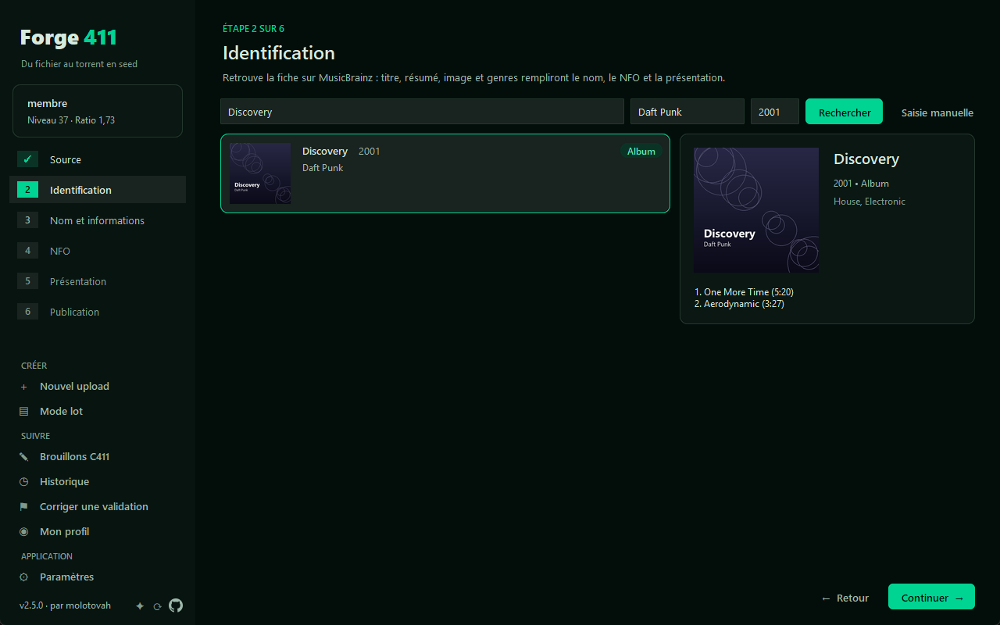
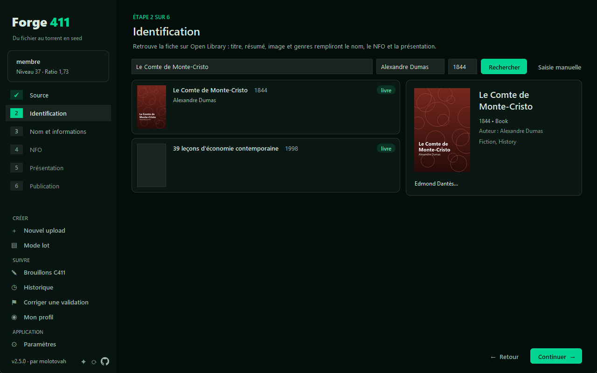
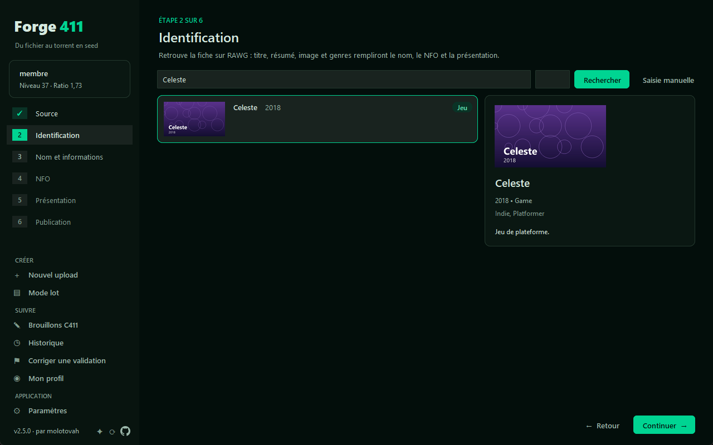
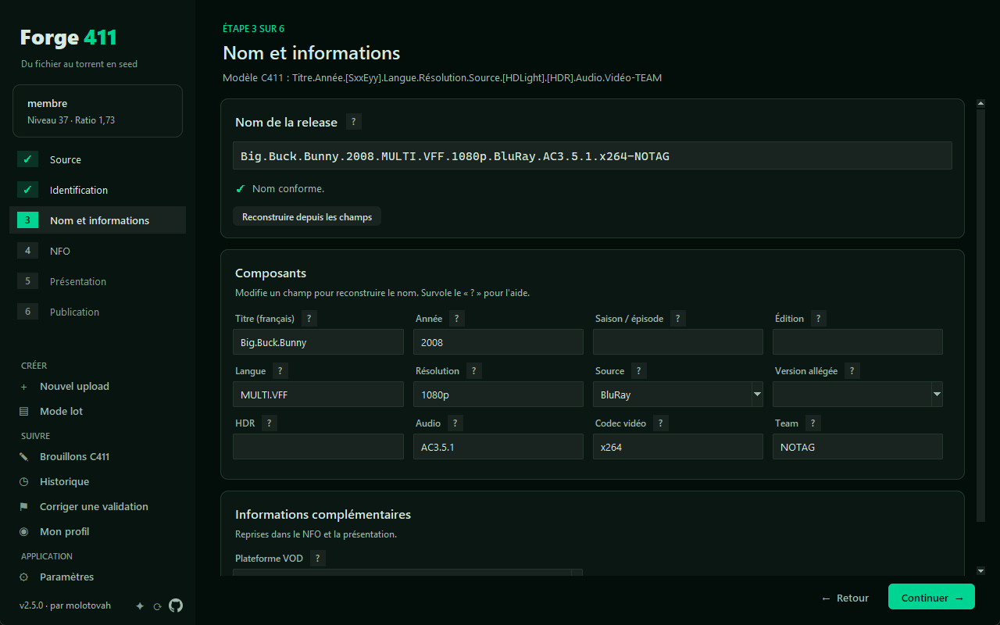
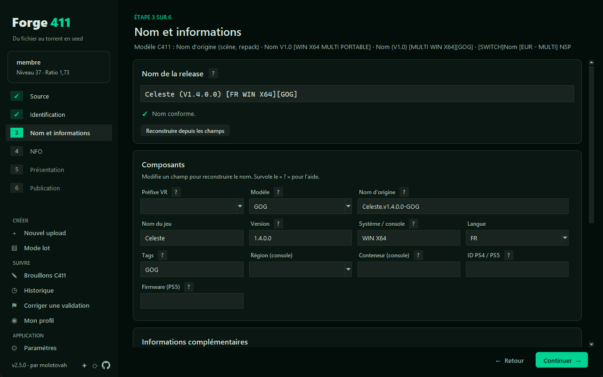
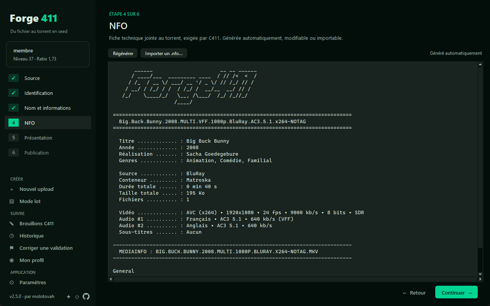
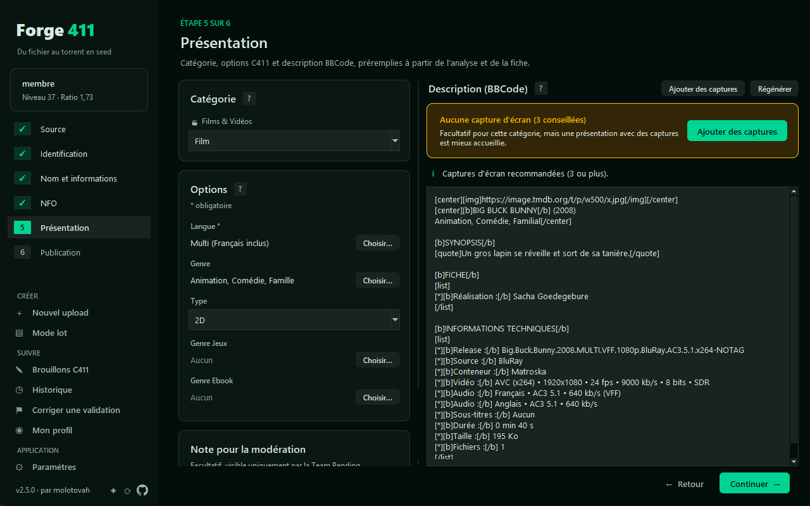
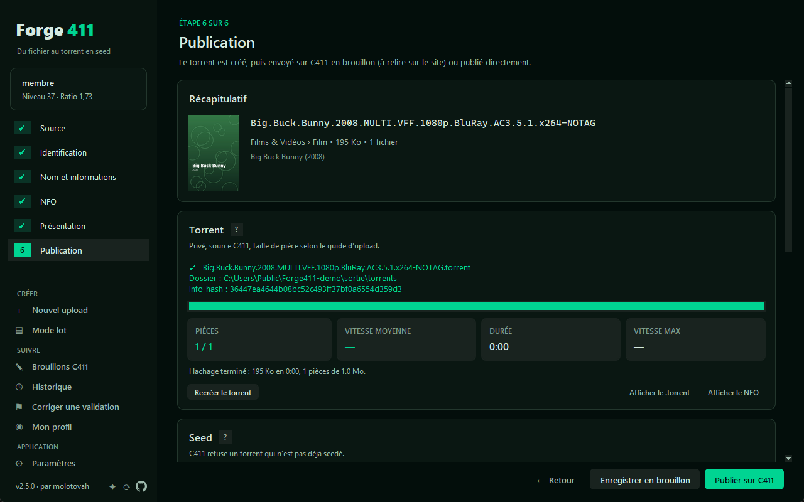

# Assistant pas à pas

L'assistant mène un upload en 6 étapes. Chaque étape est sauvegardée : après une fermeture ou un plantage, Forge411 propose de reprendre l'upload au lancement suivant.

Les problèmes bloquants sont en rouge, les conseils en orange.

## 1. Source

Choisis un fichier ou un dossier. Forge411 reconnaît le type de contenu, propose la sous-catégorie C411 et affiche ce qu'il a lu. Pour une vidéo dont le débit n'est pas indiqué, le premier fichier est analysé en entier (quelques secondes) : C411 exige le débit vidéo dans le NFO. Si le type est mal reconnu, change-le dans la liste : l'analyse est relancée.

**Ouvrir l'emplacement** affiche la source dans l'explorateur. Si un dossier de seed est réglé et que la source n'y est pas, **Déplacer dans le dossier de seed** l'y déplace. Pendant la copie s'affichent les fichiers copiés, la vitesse, le temps écoulé et restant, et la courbe de vitesse ; à la fin, un bilan reste affiché : vitesse moyenne et maximale, durée.

## 2. Identification

La fiche est cherchée et sélectionnée automatiquement sur TMDB, MusicBrainz, Open Library, RAWG ou ThePornDB. Clique sur un autre résultat si ce n'est pas le bon, ou passe en **saisie manuelle**. Pour un film ou une série, Forge411 liste aussi les releases déjà présentes sur C411.

Musique, livres et jeux

## 3. Nom et informations

Le nom est construit selon le modèle C411 de la catégorie, rappelé en haut de l'écran. Modifie un composant pour reconstruire le nom ; il est vérifié en direct. Plus bas, les **informations complémentaires** (plateforme VOD, version, configuration requise, instructions d'installation…) alimentent le NFO et la présentation.

Pour un jeu ou une application, le type de release est déduit des fichiers présents, selon la table de C411 :

Le nom de tes fichiers d'origine est conservé, comme le demande C411 pour les réuploads. Si un fichier vidéo ne se termine pas par le tag de team (règle anti-detag), Forge411 propose de l'ajouter (`Episode.01.mkv` → `Episode.01-TEAM.mkv`).

## 4. NFO

Le NFO est généré : en-tête, fiche, informations techniques, liste des fichiers et, pour une vidéo, la sortie MediaInfo complète. Tu peux le modifier ou importer le NFO d'origine de la release.

## 5. Présentation

La sous-catégorie et les options C411 sont préremplies ; les options obligatoires manquantes apparaissent en rouge. La description BBCode (image, résumé, fiche, informations techniques) est prête et modifiable.

> [!IMPORTANT]
> C411 exige une image. Sans fiche en ligne, colle l'adresse d'une image dans la fiche manuelle.

Quand des captures d'écran manquent, un encart orange au-dessus de la description indique combien il en faut, avec un bouton **Ajouter des captures** : voir [Captures d'écran](<Captures-d’écran>).

## 6. Publication

Forge411 crée le torrent, affiche ce qu'il reste à vérifier, puis l'envoie. Pendant le hachage du torrent, des tuiles indiquent les pièces hachées, la vitesse, le temps écoulé et le temps restant, avec la courbe de vitesse ; à la fin, le bilan : vitesse moyenne et maximale, durée. Le seed est ensuite vérifié dans ton client : voir [Client torrent et seed](Client-torrent-et-seed).

- **Enregistrer en brouillon** : tout part sur C411 sans être publié. Sur la page d'upload du site, clique sur **Brouillons** puis sur ton brouillon pour le relire et le publier. Idéal pour commencer.
- **Publier sur C411** : publication directe. Le bouton reste grisé tant que le seed n'est pas vérifié (client configuré) ou confirmé (case à cocher), et tant que la présentation n'a pas ses captures.

Les boutons **Afficher le .torrent**, **Afficher le NFO** et **Dossier des captures** ouvrent les fichiers produits dans l'explorateur.

> [!TIP]
> Tant que tu n'es pas uploader certifié, C411 n'accepte qu'un upload à la fois en attente de validation : voir [Brouillons et historique](Brouillons-et-historique#un-seul-upload-en-attente-tant-que-tu-nes-pas-certifié).

La section **Déjà sur C411** de cette étape est détaillée dans [Doublons et slots](Doublons-et-slots).
