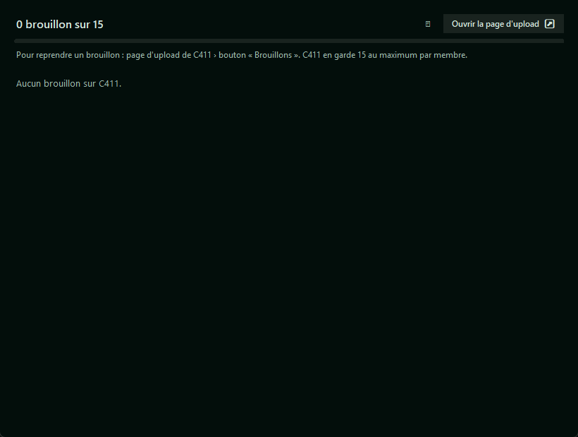
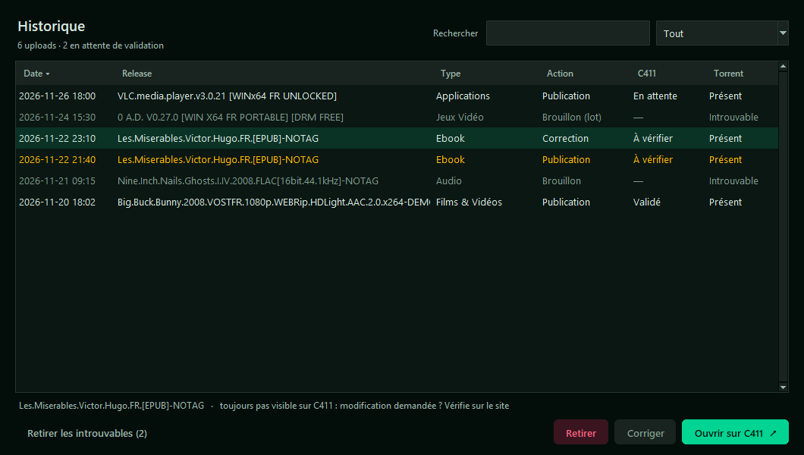
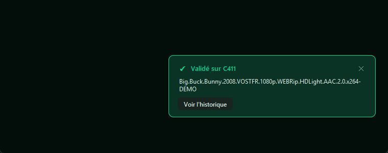

# Brouillons et historique

## Brouillons C411

<picture>
  <source media="(prefers-color-scheme: light)" srcset="https://raw.githubusercontent.com/molotovah/Forge411/main/docs/screenshots/21-brouillons-clair.png">
  
</picture>

**Brouillons C411** (menu Suivre) liste tes brouillons avec un compteur sur 15, ouvre la page d'upload pour les reprendre et permet d'en supprimer.

## Historique

<picture>
  <source media="(prefers-color-scheme: light)" srcset="https://raw.githubusercontent.com/molotovah/Forge411/main/docs/screenshots/25-historique-clair.png">
  
</picture>

**Historique** liste tes uploads dans un tableau :

- clique sur un en-tête pour trier ; cherche par nom ou par type ; filtre : publiés, brouillons, corrections, en attente C411, torrent introuvable ;
- la colonne **Torrent** indique si le fichier .torrent existe encore ;
- un double-clic ouvre la page sur C411 ;
- le clic droit propose de copier le nom, d'afficher le .torrent, de corriger l'upload ou de le marquer comme refusé ;
- **Retirer** (ou la touche Suppr) enlève les lignes sélectionnées, **Retirer les introuvables** enlève d'un coup les uploads dont le .torrent a disparu.

> [!NOTE]
> Retirer une ligne ne change que l'historique : rien n'est supprimé sur C411, et les .torrent restent sur le disque.

## Suivi de la validation

La colonne **C411** suit la validation par la Team Pending. Forge411 interroge C411 au démarrage, à l'ouverture de l'historique, puis toutes les 30 minutes pour chaque upload publié pas encore validé. Une notification s'affiche dès qu'un torrent passe **Validé**, et l'heure de validation est notée.

| Statut | Signification |
|---|---|
| **En attente** | Pas encore visible sur C411 |
| **À vérifier** | Toujours pas visible plus de 3 jours après la dernière soumission : une modification a peut-être été demandée, vérifie sur le site |
| **Validé** | Visible sur C411 |
| **Refusé** | Marqué refusé (par C411 ou par toi) |

L'API ne montre un torrent qu'une fois validé : un torrent refusé ou supprimé reste invisible, comme un torrent en attente. Marque-le avec le clic droit, **Marquer comme refusé ou supprimé**, pour qu'il ne compte plus comme en attente. Les brouillons ne sont pas suivis.

Une fois le torrent validé, Forge411 supprime ses captures et son NFO du dossier de sortie : ils sont en ligne avec le torrent.

## Un seul upload en attente tant que tu n'es pas certifié

Tant que tu n'es pas **uploader certifié** (15 torrents validés), C411 n'accepte qu'un upload à la fois en attente de la Team Pending, modification demandée comprise.

- Si un upload publié avec Forge411 attend encore sa validation, l'étape Publication le signale et conseille d'enregistrer le nouveau en brouillon ; **Publier** demande alors confirmation.
- Quand il est validé, la notification indique que tu peux publier le suivant.

L'API ne donne pas ce statut : Forge411 compte les uploads validés de son historique. Les uploads faits directement sur le site ne sont pas comptés.

> [!TIP]
> Déjà certifié ? Coche la case dans **Paramètres › Uploads › Statut d'uploader**.
