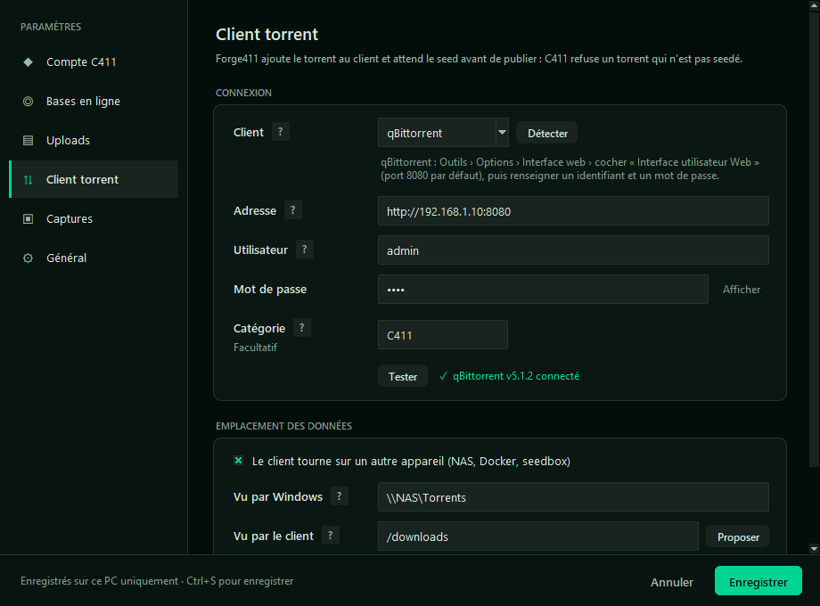

# Client torrent et seed

C411 refuse un torrent publié qui n'est pas déjà seedé. Forge411 peut piloter ton client torrent pour toi : il y ajoute le torrent qu'il vient de créer, attend que le client ait vérifié les données, et n'autorise **Publier** qu'une fois le torrent **En seed**. Ce guide se suit pas à pas. Choisis ton cas :

| Ton client torrent tourne… | Cas |
|---|---|
| sur ce PC (qBittorrent, Transmission ou Deluge installé sous Windows) | [A. Client sur ce PC](#a-client-sur-ce-pc) |
| sur une autre machine chez toi (NAS, serveur, conteneur Docker) | [B. NAS ou Docker](#b-nas-ou-docker) |
| chez un hébergeur, sur Internet (seedbox) | [C. Seedbox dans le cloud](#c-seedbox-dans-le-cloud) |

**Ce que Forge411 impose au torrent ajouté**, quels que soient les réglages de ton client (inutile de les changer) :

- les données sont toujours **vérifiées** : un mauvais emplacement est détecté au lieu d'afficher un faux « En seed » ;
- la **disposition d'origine** des fichiers est gardée (qBittorrent : pas de sous-dossier ajouté ou retiré) ;
- le torrent est **démarré de force**, hors file d'attente : un torrent « en file » n'annonce rien au tracker ;
- **aucune limite** de ratio ni de durée de seed : ton client ne l'arrêtera pas de lui-même.

## A. Client sur ce PC

**1. Active l'interface web de ton client.** Forge411 dialogue avec le client par cette interface.

- **qBittorrent** : menu **Outils › Options › Interface Web**. Coche **Interface utilisateur Web (contrôle distant)**, garde le port **8080**, puis choisis un **nom d'utilisateur** et un **mot de passe** dans *Authentification*. Clique sur **OK**.
- **Transmission** : menu **Édition › Préférences**, onglet **Distant**. Coche **Autoriser l'accès distant**, garde le port **9091**. Coche l'authentification et choisis un nom d'utilisateur et un mot de passe.
- **Deluge** : menu **Édition › Préférences › Modules**, coche **WebUi** (port **8112**). Le mot de passe par défaut est `deluge` : change-le depuis l'interface web (http://localhost:8112, *Préférences › Interface*).

Le client doit rester ouvert pendant que tu utilises Forge411.

**2. Choisis ton dossier de seed.** C'est le dossier où ton client garde les fichiers qu'il partage, par exemple `D:\Torrents\Seed`. Dans Forge411 : **Paramètres › Uploads › Dossier de seed**. Les sources que tu publies doivent s'y trouver, directement (pas dans un sous-dossier) : Forge411 le vérifie et propose d'y déplacer la source.

**3. Connecte Forge411 au client.** **Paramètres › Client torrent** :

| Champ | Valeur |
|---|---|
| Client | qBittorrent, Transmission ou Deluge (ou clique sur **Détecter**) |
| Adresse | `http://localhost:8080` (qBittorrent), `http://localhost:9091` (Transmission) ou `http://localhost:8112` (Deluge) |
| Utilisateur / Mot de passe | ceux choisis à l'étape 1 (Deluge : mot de passe seul) |
| Catégorie | `C411` par exemple, pour retrouver tes uploads dans le client (facultatif) |

Clique sur **Tester** : la ligne doit afficher « qBittorrent 5.x connecté » (ou l'équivalent). Laisse **décochée** la case *Le client tourne sur un autre appareil* et **cochée** *Ajouter le torrent au client dès sa création*. Clique sur **Enregistrer**.

**4. Vérifie avec un premier upload.** À l'étape **Publication** de l'[assistant](<Assistant-pas-à-pas#6-publication>), le torrent est créé puis ajouté au client. La section **Seed** affiche la vérification (vitesse, temps restant), puis **✓ En seed dans qBittorrent**. Dans ton client, le torrent apparaît dans la catégorie choisie, en partage. Commence par **Enregistrer en brouillon** si tu veux t'entraîner sans rien publier.

## B. NAS ou Docker

Le client tourne sur une autre machine de ton réseau, et ses fichiers sont dans un dossier partagé que Windows voit, par exemple `\\192.168.1.251\Torrents`.

1. **Interface web** : active-la comme au cas A. Elle doit être joignable depuis ton PC : ouvre son adresse (par exemple `http://192.168.1.251:8080`) dans ton navigateur pour vérifier. Pour Docker, le port doit être publié par le conteneur.
2. **Dossier de seed** : dans **Paramètres › Uploads › Dossier de seed**, indique le dossier partagé **tel que Windows le voit**, par exemple `\\192.168.1.251\Torrents\c411`.
3. **Connexion** : dans **Paramètres › Client torrent**, choisis le client et mets son adresse réseau (`http://192.168.1.251:8080`), l'utilisateur et le mot de passe. Clique sur **Tester**.
4. **Correspondance des dossiers** : coche **Le client tourne sur un autre appareil (NAS, Docker, seedbox)**. Le même dossier a deux noms :

   | Champ | Exemple | Ce que c'est |
   |---|---|---|
   | Vu par Windows | `\\192.168.1.251\Torrents` | le début du chemin côté PC |
   | Vu par le client | `/downloads` | le même dossier dans le client (le chemin du volume Docker, par exemple) |

   **Proposer** les déduit de ton dossier de seed et du dossier par défaut du client. Sous les champs, l'aperçu montre le chemin exact transmis au client : il doit correspondre à un dossier que le client connaît. Le nom de la machine et son adresse IP désignent le même partage : `\\NAS\Torrents` et `\\192.168.1.251\Torrents` conviennent tous deux.
5. **Enregistrer**, puis vérifie avec un premier upload comme au cas A.

## C. Seedbox dans le cloud

Ton client tourne chez un hébergeur. Deux conditions : Forge411 doit lire les fichiers depuis ton PC (analyse, captures, création du torrent), et le client doit les trouver sur la seedbox, avec les **mêmes noms**.

1. **Adresse de l'interface web** : ton hébergeur la donne dans son espace client, par exemple `https://serveur.hebergeur.com/ton-compte/qbittorrent`. Ouvre-la dans ton navigateur pour vérifier qu'elle répond. Dans **Paramètres › Client torrent**, choisis le client, colle cette adresse **sans** `/api/…` à la fin, puis l'utilisateur et le mot de passe de l'interface. Clique sur **Tester**.
2. **Dossier de téléchargement du client** : dans l'interface web, note le dossier où il enregistre les fichiers, par exemple `/home/ton-compte/downloads` (qBittorrent : *Options › Téléchargements › Dossier par défaut*). C'est le chemin **Vu par le client**.
3. Choisis ensuite **une** des deux méthodes.

**C1. Les fichiers sont déjà sur la seedbox** (tu les y as téléchargés) : monte le dossier de la seedbox comme un lecteur Windows, en SFTP, avec un outil comme RaiDrive ou rclone. Par exemple, `/home/ton-compte/downloads` devient `S:\`.

| Réglage | Exemple |
|---|---|
| Paramètres › Uploads › Dossier de seed | `S:\` |
| Le client tourne sur un autre appareil | coché |
| Vu par Windows | `S:\` |
| Vu par le client | `/home/ton-compte/downloads` |
| Ajouter le torrent au client dès sa création | coché |

Forge411 lit les fichiers à travers Internet : l'analyse et la création du torrent prennent le temps de lire toute la release une fois (environ 15 min pour 10 Go à 100 Mbit/s). Le reste fonctionne comme au cas A.

**C2. Les fichiers sont sur ton PC** : prépare l'upload sur le PC, puis envoie les fichiers sur la seedbox avant de les ajouter au client.

| Réglage | Exemple |
|---|---|
| Paramètres › Uploads › Dossier de seed | `D:\Seed` (un dossier de ton PC) |
| Le client tourne sur un autre appareil | coché |
| Vu par Windows | `D:\Seed` |
| Vu par le client | `/home/ton-compte/downloads` |
| Ajouter le torrent au client dès sa création | **décoché** |

Pour chaque upload :

1. Avance jusqu'à l'étape **Publication** : Forge411 a renommé les fichiers et crée le torrent.
2. Envoie le dossier (ou le fichier) de la release de `D:\Seed` vers `/home/ton-compte/downloads` sur la seedbox, avec FileZilla ou WinSCP (SFTP). Garde exactement le même nom.
3. Une fois le transfert terminé, clique sur **Ajouter au client torrent** dans la section **Seed**. Le client vérifie les fichiers puis passe **En seed**.
4. Publie, ou enregistre en brouillon.

Si tu cliques trop tôt, le client ne trouve pas tout et Forge411 l'indique (« Le client ne trouve pas toutes les données ») : termine le transfert puis clique à nouveau.

## Si ça ne marche pas

| Message | Cause et solution |
|---|---|
| `… injoignable (adresse) : ConnectionError` | Interface web désactivée, client fermé, mauvais port ou adresse. Ouvre l'adresse dans ton navigateur : elle doit afficher la page de connexion du client. |
| `identifiant ou mot de passe refusé` | Vérifie l'utilisateur et le mot de passe de l'**interface web** (pas ceux de ton compte C411 ni de la seedbox). |
| `trop d'échecs de connexion, adresse IP bannie temporairement` | qBittorrent bloque ton PC après plusieurs erreurs : attends une heure, ou redémarre qBittorrent, puis corrige le mot de passe. |
| `Fichiers introuvables à l'emplacement indiqué` ou `Le client ne trouve pas toutes les données` | Le client cherche les fichiers ailleurs. Regarde le chemin affiché dans la section Seed et l'aperçu des Paramètres : il doit désigner le dossier qui contient la release. Corrige le dossier de seed ou la correspondance des dossiers. En seedbox (C2), vérifie que le transfert est terminé et que le nom est identique. |
| `le torrent est complet mais ne seed pas` | Le client a gardé le torrent en pause ou en file d'attente. Dans le client, clic droit sur le torrent › **Démarrage forcé**, puis clique à nouveau sur **Ajouter au client torrent**. |
| `Le torrent n'apparaît pas dans le client` | Le client a refusé le fichier : regarde ses messages. Un torrent avec le même contenu est peut-être déjà présent. |

## Sans client configuré

Sans client dans les Paramètres, ajoute toi-même chaque torrent à ton client, avec le dossier de seed comme emplacement des données, puis coche la case de la section **Seed** une fois le partage démarré. Pour automatiser l'ajout :

1. Dans ton client torrent, fais surveiller le dossier `torrents` du **dossier de sortie** de Forge411.
2. Comme emplacement des données, indique ton **dossier de seed**, celui où se trouvent les fichiers partagés.

> [!WARNING]
> **qBittorrent** supprime les `.torrent` d'un dossier surveillé dès qu'il les a ajoutés. Forge411 a encore besoin du fichier au moment de l'envoi : fais surveiller une **copie** du dossier (par une synchronisation) plutôt que le dossier lui-même.
