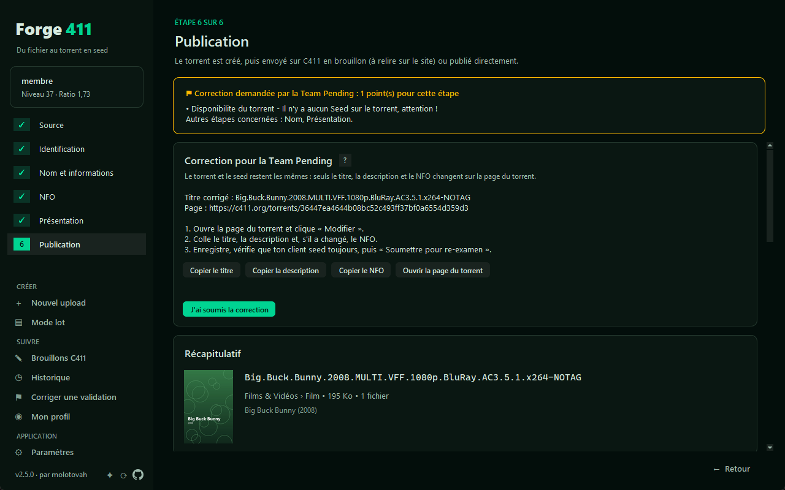

# Corriger une validation

Quand la Team Pending passe ton torrent en **Modification demandée** :

1. Clique sur **Corriger une validation** (menu Suivre), ou sur **Corriger** dans l'[historique](Brouillons-et-historique).
2. Choisis l'upload et colle le message de la Team Pending, copié depuis *Discussion de modération* sur la page du torrent.
3. Forge411 rouvre l'upload, avec le même .torrent et le même seed, puis avance seul : il choisit la fiche, recalcule le nom avec les règles actuelles (en reprenant du titre publié ce qui manque au nom du fichier) et régénère le NFO et la présentation.
4. Il s'arrête à la première étape qui te demande une action, par exemple les captures. Chaque étape affiche les points de la Team Pending qui la concernent.
5. À l'étape Publication, copie le titre, la description et le NFO corrigés, puis ouvre la page du torrent.
6. Sur le site, clique sur **Modifier**, colle, enregistre, puis clique sur **Soumettre pour re-examen**.

> [!NOTE]
> L'API C411 ne permet pas de modifier un torrent à ta place : la dernière étape se fait sur le site. Le torrent et le seed restent les mêmes.
