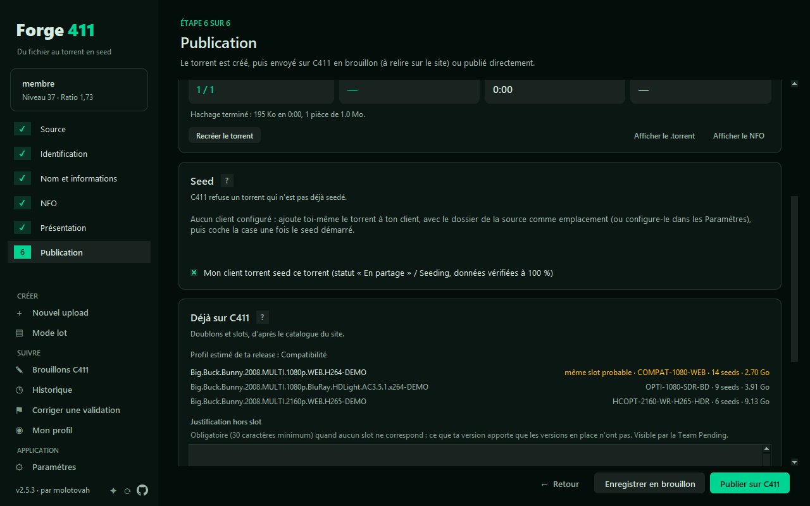

# Doublons et slots

À l'étape Publication, **Déjà sur C411** cherche les releases existantes (API Torznab de C411) :

- même nom : doublon, refusé par C411 ;
- releases du même profil de slot (Home Cinéma Pure, Home Cinéma Optimisé, Optimisation, Compatibilité) et de même résolution.

Si le slot semble occupé, rédige la **justification hors slot** (30 caractères minimum) : ce que ta version apporte que les versions en place n'ont pas. Elle est envoyée avec l'upload et visible par la Team Pending.

> [!NOTE]
> L'avis de Forge411 est une estimation : l'attribution réelle du slot reste décidée par C411.
