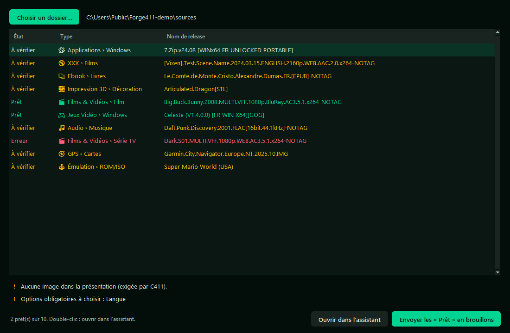

# Mode lot

Le **mode lot** (menu Créer) traite toutes les sources d'un dossier : un sous-dossier ou un fichier = une release. Pour chacune : détection, analyse, fiche en ligne quand le titre correspond, nom, NFO, présentation et options.

Chaque ligne passe à :

| Statut | Signification |
|---|---|
| **Prêt** | Tout est rempli, l'envoi peut partir |
| **À vérifier** | Doute sur la fiche, image ou option manquante : double-clique pour ouvrir l'élément dans l'assistant |
| **Erreur** | L'analyse a échoué : le détail s'affiche en sélectionnant la ligne |

**Envoyer les Prêt** crée les torrents, les ajoute au client torrent s'il est configuré et envoie des **brouillons**. La publication se fait ensuite depuis le site.

> [!NOTE]
> C411 garde au plus **15 brouillons** par membre : voir [Brouillons et historique](Brouillons-et-historique).
