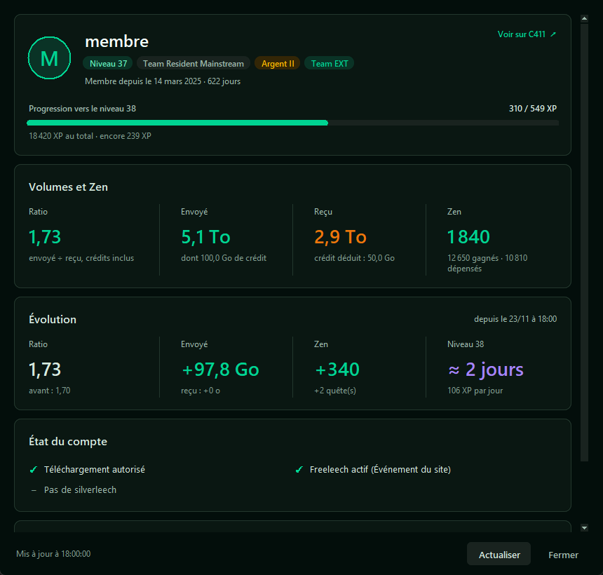

# Mon profil

<picture>
  <source media="(prefers-color-scheme: light)" srcset="https://raw.githubusercontent.com/molotovah/Forge411/main/docs/screenshots/19-profil-clair.png">
  
</picture>

**Mon profil** (et le résumé en haut de la barre latérale) affiche ton compte C411 :

- niveau et progression, classe, palier et avancement des quatre voies ;
- ratio, volumes envoyés et reçus (crédits compris), solde de Zen ;
- équipe et son tag, état du téléchargement, freeleech et silverleech.

La carte **Évolution** compare avec un relevé précédent, gardé sur ton PC (au plus un par heure) : ratio, volume envoyé, Zen, quêtes et estimation du prochain niveau.

> [!NOTE]
> La clé API doit avoir le droit **Profil (lecture)**. C411 rafraîchit ces données au plus toutes les 30 secondes.
