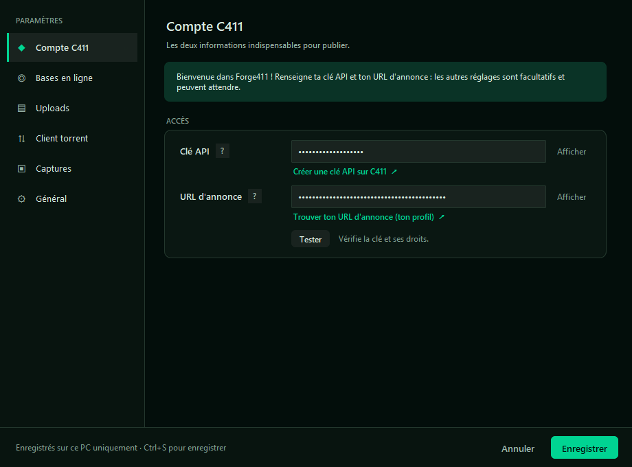
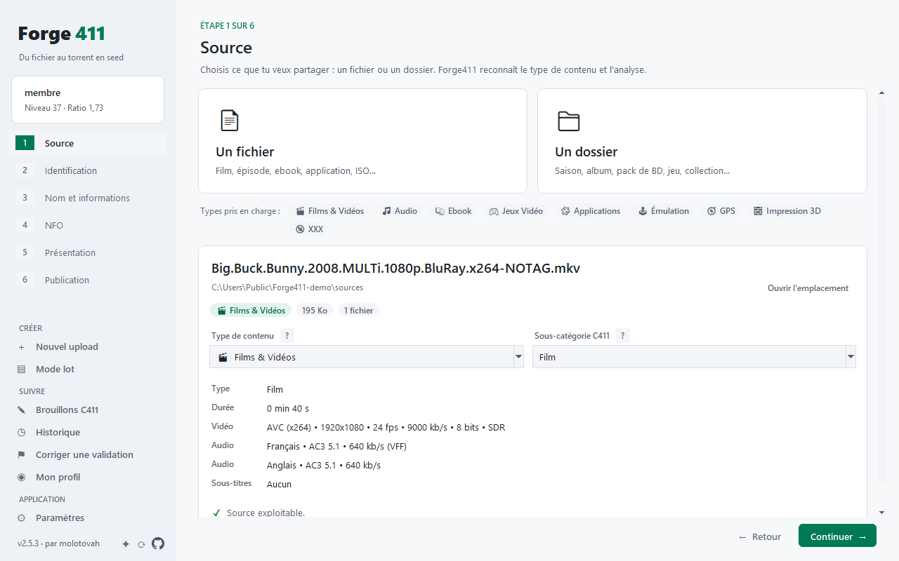
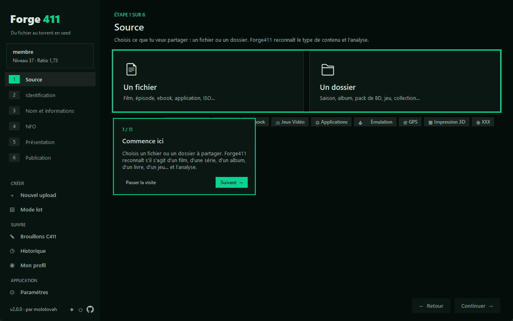
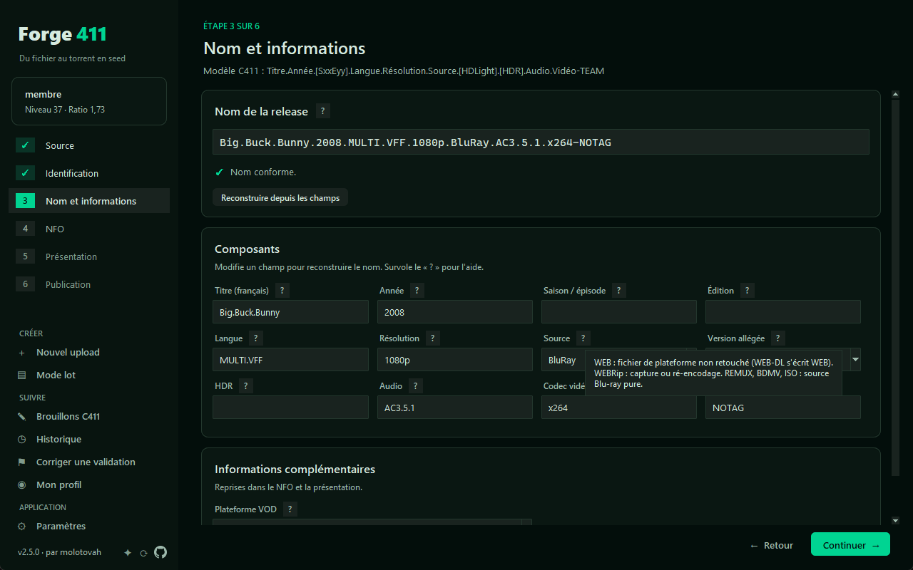

# Premier lancement

Au premier lancement, Forge411 ouvre ses **paramètres**, rangés par sections : Compte C411, Bases en ligne, Uploads, Client torrent, Captures, Général. Une pastille signale ce qui manque. Chaque clé a un lien pour l'obtenir, un bouton **Tester** et une aide au survol du **?**.

## Les réglages

| Paramètre | Obligatoire | Où le trouver |
|---|---|---|
| Clé API C411 | Oui | Sur C411 : profil › Intégrations. Coche le droit **brouillons** ; ajoute **upload** pour publier directement et **Profil (lecture)** pour la page [Mon profil](Mon-profil). |
| URL d'annonce | Oui | Ton URL personnelle `https://c411.org/announce/…`, sur ton profil C411. |
| Clé TMDB | Films et séries | [themoviedb.org › API](https://www.themoviedb.org/settings/api), gratuite. |
| Clé RAWG | Jeux | [rawg.io › API](https://rawg.io/apidocs), gratuite. |
| Clé Google Books | Non | Facultative : sans elle, Forge411 utilise Open Library. |
| Jeton ThePornDB | XXX Films et VR | Jeton personnel sur [theporndb.net](https://theporndb.net/) (compte › API Tokens). La fiche choisie (studio, date, interprètes, image) remplit le nom et la présentation. |
| Tag d'équipe | Non | Ton tag, proposé à la place de NOTAG quand la source n'a pas de tag (tes propres releases). Une release reprise garde toujours le tag d'origine. |
| Dossier de sortie | Non | Où sont écrits les `.torrent`, les `.nfo` et les captures. |
| Dossier de seed | Non | Là où ton client torrent attend les données ; Forge411 vérifie que tes fichiers s'y trouvent. |
| Uploader certifié | Non | À cocher si tu as déjà 15 torrents validés : voir [Brouillons et historique](Brouillons-et-historique#un-seul-upload-en-attente-tant-que-tu-nes-pas-certifié). |
| Apparence | Non | **Système** (suit Windows), **Sombre** ou **Clair**, aux couleurs de C411. Appliqué au redémarrage. |

> [!IMPORTANT]
> Un droit ne s'ajoute pas à une clé API existante : pour en ajouter un, crée une nouvelle clé.

> [!CAUTION]
> L'URL d'annonce identifie ton compte. Ne la partage jamais, ni en capture d'écran.

La musique (MusicBrainz) et les livres (Open Library) ne demandent aucune clé. Sans clé TMDB ou RAWG, tu peux toujours saisir la fiche à la main.

Chaque dossier a un bouton **Ouvrir** qui l'affiche dans l'explorateur.

## Mode clair

## Visite guidée et aide au survol

Au premier lancement, une visite guidée présente l'interface. Relance-la à tout moment avec l'icône ✦, en bas du menu de gauche, à côté de la version.

Partout, survole un **?** pour savoir à quoi sert un champ.

Étape suivante : [Assistant pas à pas](<Assistant-pas-à-pas>), ou [Client torrent et seed](Client-torrent-et-seed) pour automatiser le seed.
